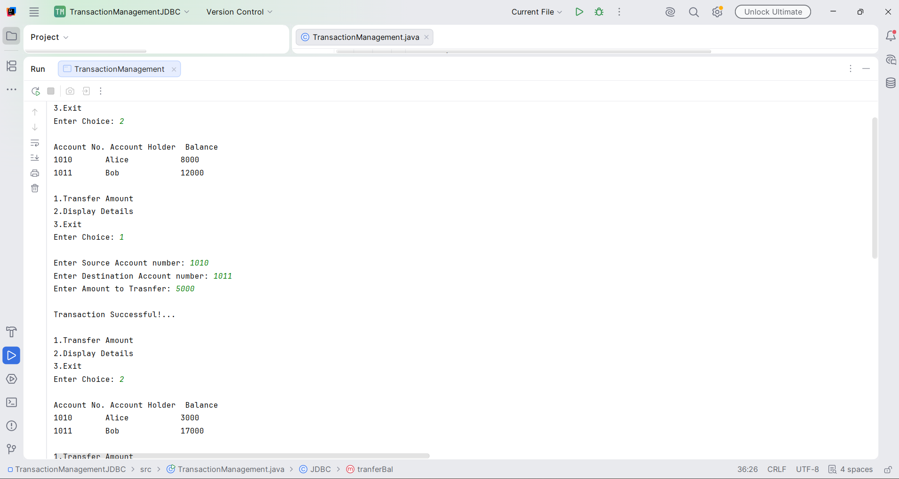
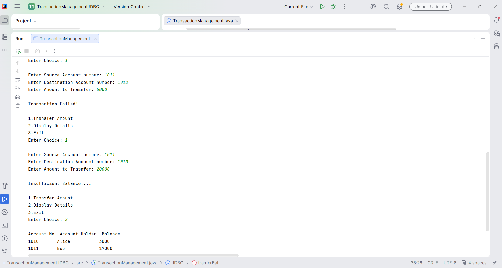

# Transaction Management System using Java JDBC

## 📌 Overview
A console-based Java application that simulates bank fund transfers using JDBC and an SQL database. It demonstrates how to manage transactions safely using database transaction management.

## 🚀 Features
- Display bank account details and balances
- Transfer funds between accounts
- Validate source and destination accounts
- Check for sufficient balance before transferring
- Use SQL queries to update account balances
- Commit successful transactions
- Roll back failed transactions to maintain data consistency

## 🛠️ Technologies Used
- Java
- JDBC (Java Database Connectivity)
- MySQL
- IntelliJ IDEA

## ⚙️ How It Works
1. Select an operation from the console menu.
2. View account details or initiate a fund transfer.
3. Enter the source account number, destination account number, and transfer amount.
4. The application checks account validity and available balance.
5. If the transfer succeeds, the changes are committed to the database.
6. If the transfer fails, the transaction is rolled back where applicable.

## 🗄️ Database Structure
The application uses a `Bank` table with the following columns:

| Column | Description |
|---|---|
| `acc_no` | Account number |
| `acc_holder` | Account holder name |
| `balance` | Account balance |

## ▶️ How to Run
1. Install Java JDK and configure your SQL database.
2. Create the `Bank` table and insert sample account records.
3. Add the appropriate JDBC driver to your project.
4. Configure the database URL, username, and password.
5. Run `TransactionManagement.java` from your IDE.
6. Use the console menu to test transfers and view account details.

## 📷 Sample Output
Add screenshots showing:
- Account details before and after a successful transfer
- A successful transaction
- A failed transaction due to insufficient balance or an invalid destination account

## 📚 What I Learned
- Connecting Java applications to SQL databases using JDBC
- Executing SQL queries with `PreparedStatement`
- Managing database transactions with `commit()` and `rollback()`
- Handling SQL exceptions
- Maintaining data consistency during fund transfers

## 👨‍💻 Author
Yedula Prashanth Goud
## 📸 Output Screenshots

### ✅ Successful Transaction

### ❌ Failed Transaction

